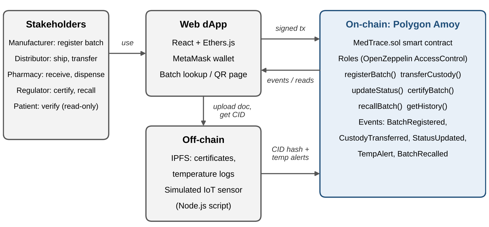

# MedTrace: Blockchain-Based Provenance for Pharmaceutical Supply Chains

**CSE 540: Engineering Blockchain Applications (Fall B 2026), Project 1**
**Team BlockRx:** Shrey Bishnoi, Maulik Jadav, Neric Joel, Vaibhav Abhiramacheri, Rohan Chandrashekar

> **Status: Smart Contract Design Draft (due 11/01/2026).** The contract interfaces, roles, storage, and core rules are written and compile. Items marked `TODO` in the code are planned for the Interim Demo (11/15) and Final Project (12/04).

---

## 1. Project Description

Prescription medicines pass through manufacturers, distributors, and pharmacies, and each of them keeps its own records. Because there is no shared, tamper-proof history, counterfeit or badly stored drugs can slip into the chain, and patients cannot easily check where their medicine came from.

**MedTrace** records every **batch** (one production lot of one medicine) on a blockchain:

- **Origin:** who made the batch, when, and its allowed storage temperature range
- **Custody:** every hand-off, signed by both the sender and the receiver
- **Documents:** certificates and logs stored on IPFS, with only their hashes (CIDs) kept on-chain
- **Cold chain:** temperature alerts from a simulated IoT sensor
- **Regulator actions:** certification and recalls

Anyone, including a patient, can look up a batch and see its full history and a simple **"safe to use"** answer.

### Stakeholders and roles

| Role | Who | What they can do on-chain |
|---|---|---|
| Admin | Network operator (deployer) | Onboard or remove participants |
| Manufacturer | Drug maker | `registerBatch`, start hand-offs, attach documents |
| Distributor | Wholesaler or logistics firm | `confirmReceipt`, pass the batch on |
| Pharmacy | Retail or hospital pharmacy | `confirmReceipt`, `markDispensed` |
| Regulator | Health authority | `certifyBatch`, `recallBatch`, attach certificates |
| Sensor | IoT simulator wallet | `recordTemperatureAlert` |
| Patient | Public | Read-only: `verifyBatch`, `getHistory` (free, no wallet needed) |

## 2. Architecture



- **On-chain (Polygon Amoy testnet):** the `MedTrace` contract stores batch state, history, and document CIDs, and emits an event for every action.
- **Off-chain storage (IPFS):** Certificates of Analysis, temperature logs, and shipping records.
- **Simulated IoT (Node.js):** generates temperature readings and writes only out-of-range readings on-chain to save gas.
- **Web dApp (React + Ethers.js + MetaMask):** one page per stakeholder, plus a public "verify my medicine" page.

The full design, including the status state machine, the hand-off sequence, and the design decisions, is in [`docs/design.md`](docs/design.md).

## 3. Repository Structure

```
medtrace/
├── contracts/
│   ├── MedTrace.sol              # main contract: batches, custody, documents, alerts
│   ├── interfaces/
│   │   └── IMedTrace.sol         # public interface: types, events, function signatures
│   └── access/
│       └── MedTraceAccess.sol    # role-based access control (OpenZeppelin)
├── test/
│   └── MedTrace.test.js          # Hardhat/Chai tests (7 passing)
├── scripts/
│   ├── deploy.js                 # deploy to localhost or Polygon Amoy
│   └── seedDemo.js               # local demo data: roles + one batch end-to-end
├── offchain/
│   ├── ipfs/uploadToIpfs.js      # IPFS upload helper (draft)
│   └── iot-simulator/simulateSensor.js  # temperature sensor simulator
├── frontend/                     # React dApp (planned for Interim Demo)
├── docs/
│   ├── architecture.png          # system architecture diagram
│   └── design.md                 # detailed design notes
├── hardhat.config.js
├── package.json
└── .env.example                  # template for secrets (never commit .env)
```

## 4. Smart Contract Overview

The interface (`IMedTrace.sol`) defines every type, event, and function. `MedTrace.sol` implements it.

| Function | Caller | Purpose |
|---|---|---|
| `registerParticipant(account, role, name)` | Admin | Onboard a wallet with a role and display name |
| `registerBatch(product, lot, expiry, minTemp, maxTemp, coaCid)` | Manufacturer | Create a batch; caller becomes its first holder |
| `transferCustody(batchId, to)` | Current holder | Step 1 of a hand-off (status becomes `InTransit`) |
| `confirmReceipt(batchId)` | Receiver | Step 2 of a hand-off (status becomes `Received`) |
| `markDispensed(batchId)` | Pharmacy holder | Final step: medicine given to patients |
| `attachDocument(batchId, docType, cid)` | Holder or Regulator | Link an IPFS document |
| `recordTemperatureAlert(batchId, reading, logCid)` | Sensor | Log an out-of-range temperature |
| `certifyBatch(batchId, certCid)` | Regulator | Approve the batch |
| `recallBatch(batchId, reason)` | Regulator | Pull the batch; it is frozen afterwards |
| `getBatch` / `getHistory` / `getDocuments` | Anyone | Read the batch record, audit trail, and documents |
| `verifyBatch(batchId)` | Anyone | Returns `exists`, `safeToUse`, `status`, and `holder` for the patient page |

**Events:** `BatchRegistered`, `CustodyTransferred`, `ReceiptConfirmed`, `BatchDispensed`, `DocumentAttached`, `TempAlert`, `BatchCertified`, `BatchRecalled`, `ParticipantRegistered`, `ParticipantRemoved`.

**Batch status flow:** `Created → InTransit → Received → (InTransit → Received …) → Dispensed`. A regulator can move any batch that hasn't been dispensed to `Recalled`.

## 5. Dependencies

| Tool | Version | Purpose |
|---|---|---|
| [Node.js](https://nodejs.org/) | 18 or newer (20 LTS recommended) | Runs Hardhat and the scripts |
| [Hardhat](https://hardhat.org/) | ^2.22 | Compile, test, deploy |
| @nomicfoundation/hardhat-toolbox | ^5.0 | Ethers.js v6, Chai matchers, gas reporter, verification |
| [@openzeppelin/contracts](https://docs.openzeppelin.com/contracts/5.x/) | ^5.0 | Audited `AccessControl` |
| Solidity | 0.8.24 | Contract language (Hardhat downloads it automatically) |
| dotenv | ^16 | Loads secrets from `.env` |
| [MetaMask](https://metamask.io/) | Browser extension | Wallet for testnet transactions |
| IPFS pinning service ([Pinata](https://pinata.cloud/)) | Free tier | Off-chain document storage (Interim Demo) |

## 6. Setup

```bash
git clone <this-repo-url>
cd medtrace
npm install
cp .env.example .env    # then fill in values (only needed for testnet)
```

## 7. Usage

### Compile and test

```bash
npx hardhat compile
npx hardhat test
REPORT_GAS=true npx hardhat test    # also print gas cost per function
```

### Run locally with demo data

```bash
# Terminal 1: start a local blockchain with 20 funded test accounts
npx hardhat node

# Terminal 2: deploy, onboard one wallet per role, and move a batch to a pharmacy
npm run seed:local
```

### Run the temperature simulator (local)

After `seed:local`, set `CONTRACT_ADDRESS` and `SENSOR_PRIVATE_KEY` in `.env`. Use the sensor account's private key, which `npx hardhat node` prints as Account #5. Then run:

```bash
BATCH_ID=1 npm run iot:simulate
```

## 8. Deployment to Polygon Amoy Testnet

1. Add the Polygon Amoy network to MetaMask (Chain ID `80002`, RPC `https://rpc-amoy.polygon.technology`).
2. Get free test POL from the [Polygon faucet](https://faucet.polygon.technology/).
3. Put your deployer `PRIVATE_KEY` (use a test-only wallet) in `.env`.
4. Deploy:
   ```bash
   npm run deploy:amoy
   ```
5. (Optional) Verify the source on the block explorer:
   ```bash
   npx hardhat verify --network amoy <CONTRACT_ADDRESS> <ADMIN_ADDRESS>
   ```
6. Onboard the other team wallets with `registerParticipant` (through the dApp, Remix, or a Hardhat console).

> The deployed contract address will be added here for the Interim Demo.

## 9. Roadmap

| Milestone | Date | Scope |
|---|---|---|
| Smart Contract Design Draft | 11/01/2026 | Interfaces, roles, core logic, repo, README, initial tests ✅ |
| Interim Demo | 11/15/2026 | Amoy deployment, IPFS uploads, IoT simulator with real CIDs, first dApp pages |
| Final Project | 12/04/2026 | Complete dApp, full test coverage, gas analysis, IEEE report, presentation |

**Out of scope:** real sensor hardware, mainnet deployment, and integration with existing industry systems.

## 10. Team and Ownership

| Member | Role | Owns |
|---|---|---|
| Shrey Bishnoi | Project Manager, Team Submitter | Coordination, task board, final report |
| Maulik Jadav | Smart Contract Lead | `contracts/` |
| Neric Joel | Testing and Deployment Lead | `test/`, `scripts/`, Amoy deployment |
| Vaibhav Abhiramacheri | Front-End Developer | `frontend/` |
| Rohan Chandrashekar | Off-Chain Integration and Documentation Lead | `offchain/`, README |

**Workflow:** feature branches and pull requests, with at least one teammate reviewing each PR before merge. Tasks are tracked on the GitHub Projects board.

## 11. References

1. S. Nakamoto, "Bitcoin: A peer-to-peer electronic cash system," 2008.
2. V. Buterin, "Ethereum: A next-generation smart contract and decentralized application platform," 2013.
3. T. Bocek et al., "Blockchains everywhere – A use-case of blockchains in the pharma supply-chain," IFIP/IEEE IM, 2017.
4. MediLedger Project, "MediLedger DSCSA pilot project final report," 2020.
5. OpenZeppelin, *Access Control*: https://docs.openzeppelin.com/contracts/5.x/access-control

## License

MIT
