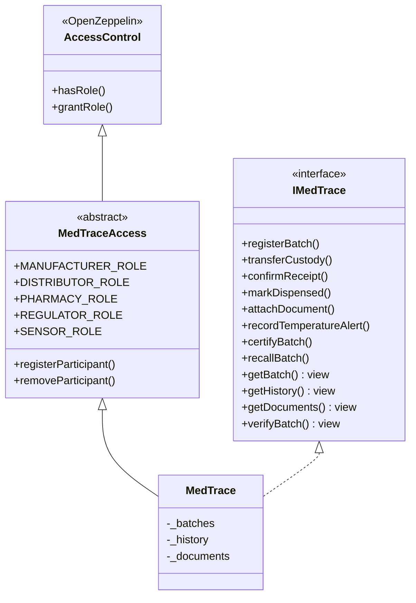
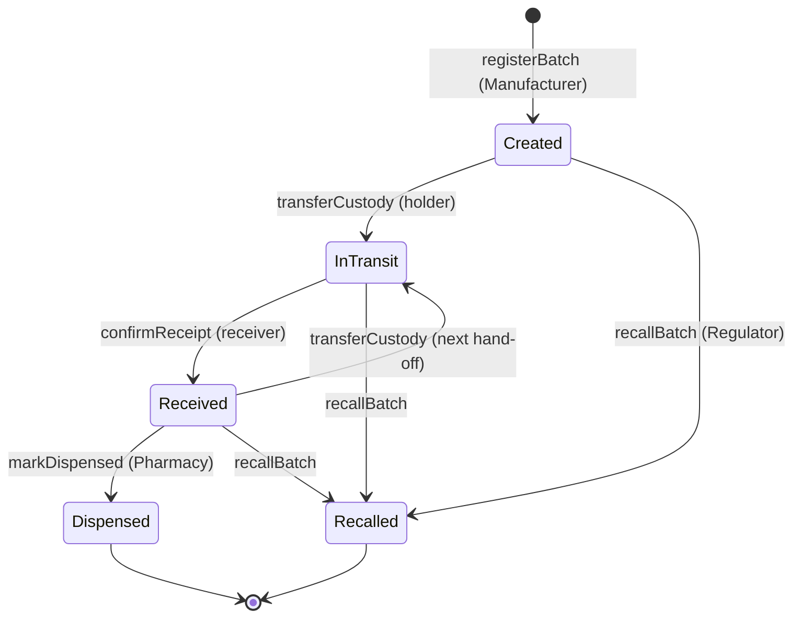
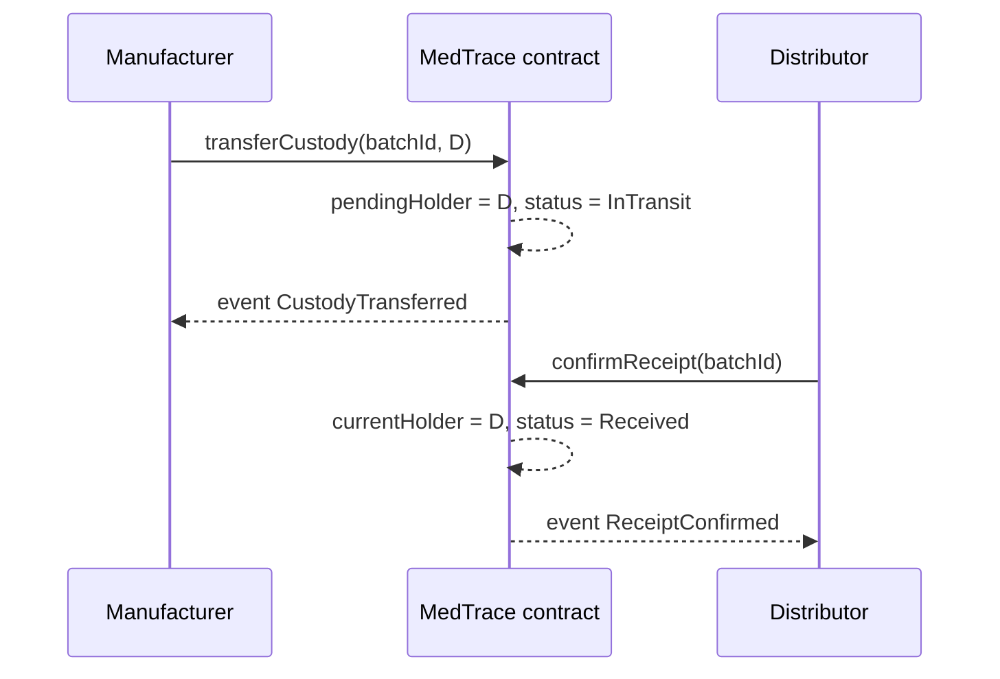

# MedTrace Design Notes

This document explains *why* the contracts look the way they do. Function-level details are in the NatSpec comments in `contracts/interfaces/IMedTrace.sol`.

## Contract components

- **IMedTrace**: the contract's public interface. The front end, scripts, and tests are written against it.
- **MedTraceAccess**: keeps permission logic separate from business logic, so roles can change without touching batch code.
- **MedTrace**: the storage and rules for batches.

## Batch status state machine

## Two-step hand-off

## Key design decisions

| Decision | Reason |
|---|---|
| **Polygon Amoy (public, EVM)** instead of Hyperledger Fabric | Patients must verify batches without permission; EVM tooling and OpenZeppelin are mature; low fees suit frequent updates. Fabric's multi-org setup is too heavy for six weeks. |
| **Two-step hand-off** (`transferCustody` + `confirmReceipt`) | Both parties sign, so no one can fake a delivery or dump a batch on someone else. |
| **Only CIDs on-chain** | Certificates and logs are large and may be sensitive; storing a hash proves integrity at a fraction of the gas cost. |
| **Only out-of-range temperatures on-chain** | Normal readings every few seconds would be expensive; alerts are what matter for safety. |
| **History stored in contract storage *and* emitted as events** | `getHistory` gives a simple one-call view for the patient page; events let the dApp update live. |
| **Temperatures as `int16` tenths of °C** | Solidity has no decimals; 2.0 °C to 8.0 °C is stored as 20 to 80. |
| **Recalled and dispensed batches are frozen** | Prevents a recalled batch from re-entering the supply chain. |
| **`verifyBatch` never reverts** | An unknown ID returns `exists = false`, which the UI shows as "not found, possibly counterfeit". |

## Known limitations and planned work

- Batch splitting (one lot shipped to several distributors) is not modeled yet. Each shipment is registered as its own batch.
- Business data is public on-chain. A production version could use private transactions or zero-knowledge proofs, as MediLedger does.
- The sensor wallet is trusted. A real system would use signed device readings or an oracle network.
- `getHistory` returns the whole array; pagination is a TODO if histories grow long.
